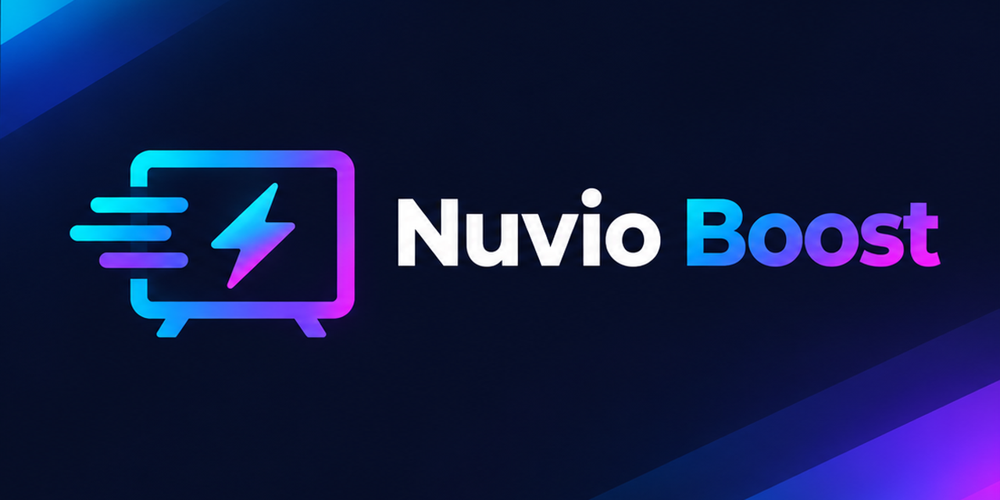

<p align="center"></p>

# Nuvio Boost

Make the sideloaded (GitHub) version of Nuvio run as smoothly as the Play Store version on Android TV, Google TV, Nvidia Shield and Fire TV.

## Why the GitHub version feels slower

Play Store installs come with performance profiles that let Android compile the app ahead of time. Sideloaded APKs skip that, so the app compiles code as it runs, which shows up as slow starts, stuttery menus and laggy posters.

Nuvio Boost tells your TV to fully compile Nuvio ahead of time with `pm compile -m speed`. Your settings, logins and trailers are not touched. It uses roughly 30–60 MB of extra storage.

**You need to run it again after every Nuvio update**, because updating replaces the compiled code.

## Why use this instead of the manual steps

The manual fix works, but you have to redo it after every Nuvio update, on every TV. Nuvio Boost turns that into a one-step job:

- **Re-applying takes seconds.** It remembers your TVs, so after an update you paste the same command and press Enter.
- **Nothing to set up on your computer.** If you don't have adb, it downloads Google's official tools into its own folder.
- **Works on Mac, Windows and Linux.** Most guides only cover Windows.
- **Does all your TVs in one go** if you have more than one.
- **Explains problems in plain English**, such as a missed popup on the TV, a Mac permission setting or a wrong IP, instead of a cryptic adb error.
- **Finds Nuvio for you**, including beta builds, so you don't need to know the package name.

## Before you start (once per TV)

Your computer and TV need to be on the same network.

**Android TV / Nvidia Shield**
1. Settings > Device Preferences > About > click **Build** 7 times.
2. Settings > Device Preferences > Developer options > turn on **Network debugging** (or USB debugging).
3. Note the TV's IP address under Settings > Network & Internet.

**Newer Google TV** (Chromecast with Google TV, recent Sony/TCL/Hisense)
1. Settings > System > About > click **Android TV OS build** 7 times.
2. Settings > System > Developer options > turn on **Wireless debugging**.
3. The script will walk you through a one-time pairing code.

**Fire TV**
1. Settings > My Fire TV > About > click your device name 7 times.
2. My Fire TV > Developer options > turn on **ADB debugging**.
3. Note the IP under My Fire TV > About > Network.

## Run it

**Mac or Linux:** open Terminal and paste:

```
curl -fsSL https://raw.githubusercontent.com/Blorp-blorp/nuvio-boost/main/run.sh | bash
```

**Windows:** open PowerShell and paste:

```
irm https://raw.githubusercontent.com/Blorp-blorp/nuvio-boost/main/run.ps1 | iex
```

Enter your TV's IP address when asked. For several TVs, separate them with spaces. The first time you connect, **look at your TV** and accept the "Allow debugging?" popup, ticking "Always allow from this computer".

Your TVs are remembered, so next time you just press Enter.

## What it does

1. Uses `adb` if you already have it. Otherwise downloads Google's official platform-tools into its own folder. Nothing is installed system-wide.
2. Connects to each TV, waits for you to approve the connection, finds Nuvio and compiles it.
3. Saves your TV addresses for next time and disconnects.

The scripts are short and readable. Please read them before running if you like.

## Troubleshooting

| Message | Fix |
|---|---|
| `Operation not permitted` (Mac) | System Settings > Privacy & Security > Local Network > turn on your Terminal app. Quit and reopen Terminal, then run again. |
| `Connection refused` | Debugging is off on the TV, or the IP is wrong. Newer Google TVs: answer **y** to the Wireless debugging question. |
| Stuck waiting / not authorized | Accept the popup on the TV. If you missed it, run again. |
| `Nuvio isn't installed` | Make sure Nuvio is installed on that TV. |
| IP keeps changing | Set a DHCP reservation for the TV in your router. |
| Windows: "running scripts is disabled" | Run `Set-ExecutionPolicy -Scope Process Bypass` in the same window, then the command again. |

## Doing it by hand

```
adb connect <TV-IP>:5555
adb shell pm list packages | grep -i nuvio      # Windows: findstr /i nuvio
adb shell pm compile -m speed -f com.nuvio.tv
```

## Removing it

Delete `~/.nuvio-boost` (Mac/Linux) or `%LOCALAPPDATA%\nuvio-boost` (Windows). To undo the compile on a TV, run `adb shell pm compile --reset com.nuvio.tv`, or just update Nuvio.

## Disclaimer

Not affiliated with Nuvio. Use at your own risk. This only changes how Android compiles the app; it doesn't modify the app itself.

## License

MIT
